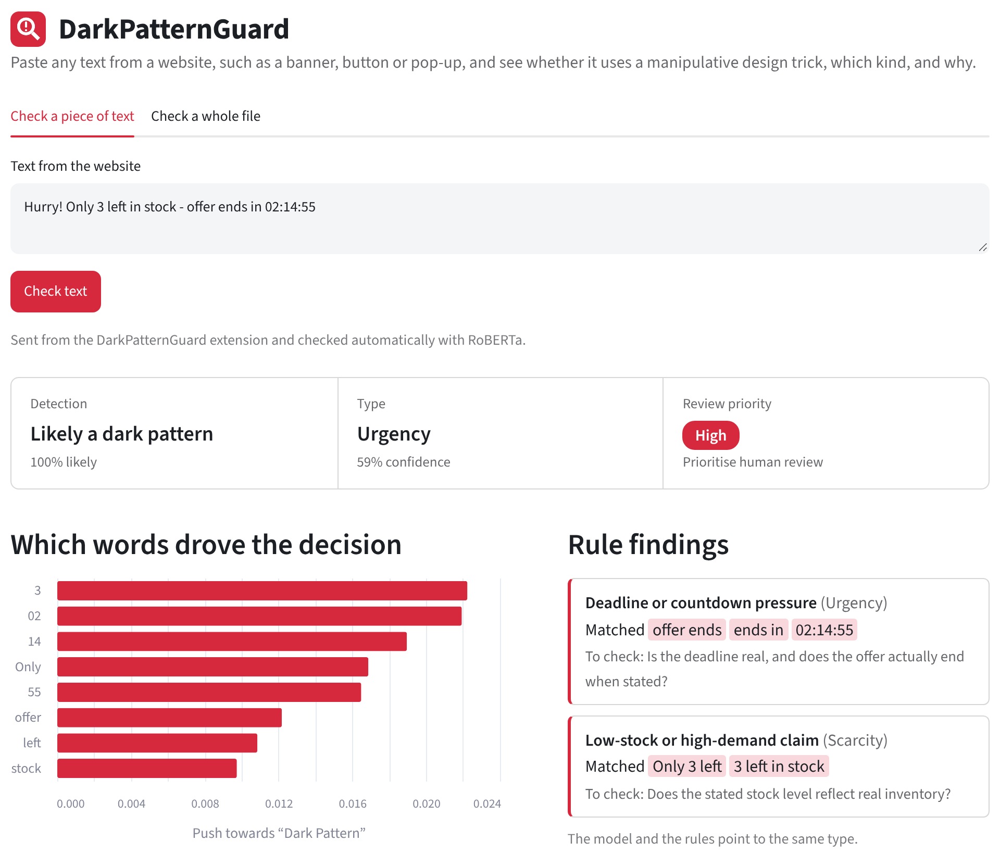
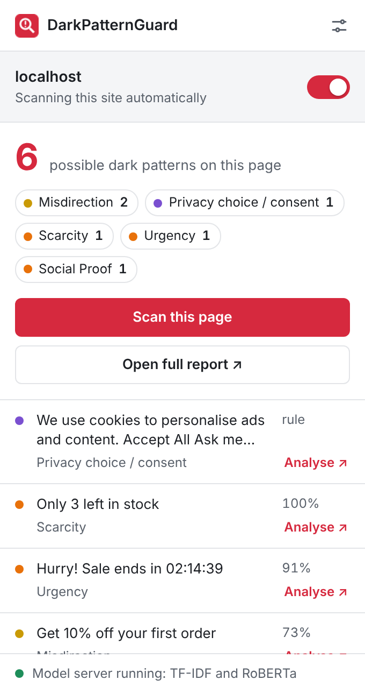
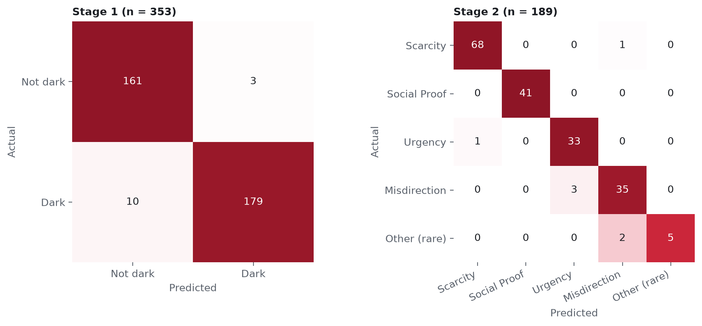
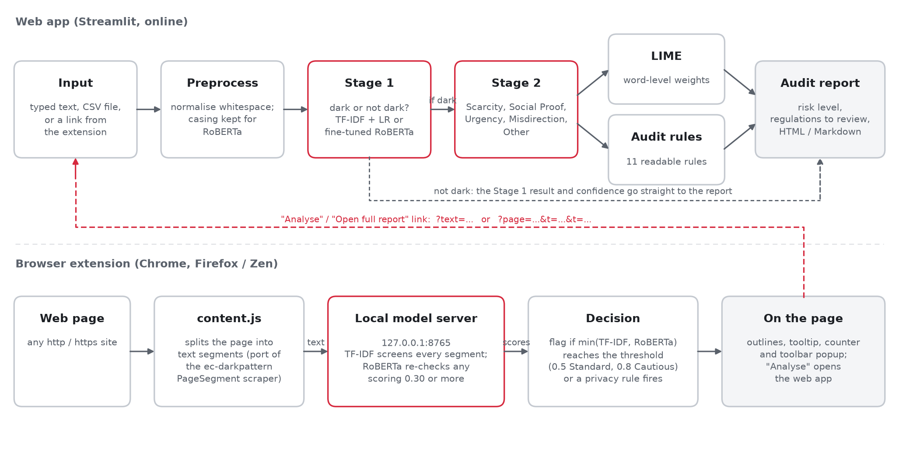
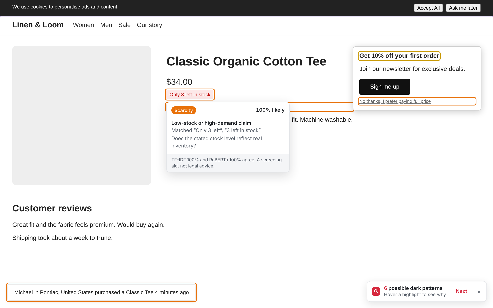
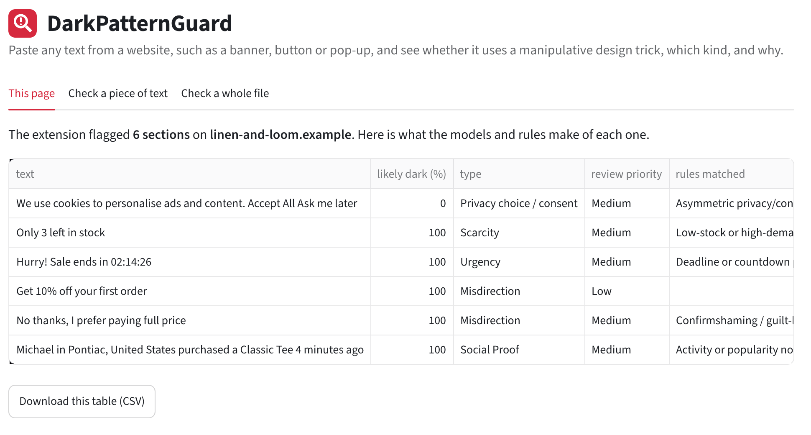

<p align="center"></p>

<h1 align="center">DarkPatternGuard</h1>

<p align="center">Finds manipulative interface text on websites, says what kind of trick it is, and shows why.</p>

<p align="center"><a href="https://darkpatternguard.streamlit.app"><b>Try it online →</b></a></p>

---

Countdown timers that reset, "only 2 left" banners, decline buttons that read *"No thanks, I don't want to save money"*,
cookie pop-ups where accepting takes one click and refusing takes five. These are **dark patterns**: design choices
that push people into decisions they wouldn't otherwise make.

DarkPatternGuard reads a piece of website text and answers three questions:

1. **Is this a dark pattern?** (Stage 1, yes or no)
2. **If so, which kind?** (Stage 2: Scarcity, Social Proof, Urgency, Misdirection, or Other)
3. **Why?** (LIME word-level explanation, 11 readable audit rules, and the regulations a reviewer may want to check)

It comes as a **web app** for checking text or whole files, and a **browser extension** that highlights possible
dark patterns on any page as you browse.

> This is a screening aid for human review. A finding is not a legal conclusion.

<p align="center">
  
  &nbsp;
  
</p>

## Contents

- [Results](#results)
- [Architecture](#architecture)
- [The models](#the-models)
- [Stage 2 types vs. audit rules](#stage-2-types-vs-audit-rules)
- [Data and splits](#data-and-splits)
- [Browser extension](#browser-extension)
- [Web app and deployment](#web-app-and-deployment)
- [Run it locally](#run-it-locally)
- [Error analysis and limitations](#error-analysis-and-limitations)
- [Future work](#future-work)
- [Project layout](#project-layout)

## Results

All models are evaluated on the same held-out test set: 353 texts for Stage 1 (164 not dark, 189 dark) and the
189 dark texts for Stage 2.

| Model | Stage 1 accuracy | Stage 1 macro-F1 | Stage 2 accuracy | Stage 2 macro-F1 | End-to-end accuracy |
|---|---|---|---|---|---|
| TF-IDF + logistic regression | 94.05% | 0.940 | 94.18% | 0.895 | 92.92% |
| RoBERTa-base, fine-tuned | **96.32%** | **0.963** | **96.30%** | **0.937** | **95.47%** |

*End-to-end* is the full six-way decision (not dark, or one of the five types) made by chaining both stages.

- RoBERTa's gain is mostly recall: at Stage 1 it missed **10** dark texts where TF-IDF missed **19**, with one more false alarm (3 vs 2).
- ROC-AUC is about 0.99 for both models at both stages, so most remaining errors are borderline cases.
- Run on a CPU instead of the Colab GPU, RoBERTa scores 96.60% at Stage 1: one prediction differs because the fp16 weights are evaluated in fp32.
- The 11 audit rules fire on **65%** of dark test texts and on **none** of the 164 not-dark ones.

**Stage 2, per category (F1):**

| Category | Test examples | TF-IDF | RoBERTa |
|---|---|---|---|
| Scarcity | 69 | 0.993 | 0.986 |
| Social Proof | 41 | 0.964 | 1.000 |
| Urgency | 34 | 0.930 | 0.943 |
| Misdirection | 38 | 0.877 | 0.921 |
| Other (rare) | 7 | 0.714 | 0.833 |

<p align="center"></p>

All metrics are saved as JSON in `results/metrics/`, with figures in `results/figures/`.

## Architecture

<p align="center"></p>

Think of it as a checkpoint with two guards and a rulebook: the first guard decides "suspicious or not", the second
decides what kind of trick it is, an explainer shows which words gave it away, and the rulebook adds evidence and the
laws to check.

**The pipeline** (`src/pipeline.py`, `src/audit_engine.py`):

| Step | What happens |
|---|---|
| 1. Input | Text typed into the web app, a CSV file, or a link from the extension |
| 2. Preprocess | Whitespace normalised. No stop-word removal or stemming, because words like "No", "only" and "now" carry the trick. TF-IDF reads a lower-cased copy; RoBERTa keeps the original casing ("HURRY!" is signal) |
| 3. Stage 1 | Dark pattern or not, with a probability |
| 4. Stage 2 | Runs only if Stage 1 says dark: Scarcity, Social Proof, Urgency, Misdirection or Other (rare) |
| 5. LIME | Removes words at random about 400 times, watches how the prediction changes, and fits a simple linear model; the 8 heaviest words are shown |
| 6. Audit rules | 11 regular-expression rules attach the matched evidence, a question for the reviewer and the regulations to check |
| 7. Report | Verdict, category, risk level (High, Medium, Low, No indicators) and regulations, downloadable as HTML or Markdown |

**Three ways in, one set of models:**

- **Web app** (`app.py`, Streamlit). Full analysis for one text, a CSV file, or a whole page sent from the extension. Runs online and locally.
- **Browser extension** (`extension/`). Splits a live page into text segments and sends them to a model server on your own computer (`server.py`, `127.0.0.1:8765`). Flagged text is outlined on the page.
- **Extension → web app.** Each finding has an **Analyse** link (`?text=…`), and **Open full report** sends every flagged section (`?page=…&t=…&t=…`). The app opens with the text filled in and runs RoBERTa straight away.

**Regulations.** Each category is mapped to provisions a reviewer may want to check, every one with a source link in
`src/regulatory_mapping.json`. Privacy-choice and consent patterns map to the CCPA/CPRA dark-pattern provisions
(Cal. Civ. Code § 1798.140(h), (l); 11 CCR § 7004). Those provisions don't cover general shopping pressure, so
Scarcity, Urgency, Social Proof and similar tactics map to the FTC Act § 5, California's UCL/FAL, SB 478 (drip
pricing) and the Automatic Renewal Law as amended by AB 2863.

## The models

Each stage can use either model. The web app lets you pick; the extension uses both together.

### TF-IDF + logistic regression (baseline)

**TF-IDF** turns text into numbers by asking how important each word is *in this text compared with all texts*.
A word scores high if it is frequent here but rare overall: "the" appears everywhere and says nothing, "stock" is
rarer and says something.

```
TF-IDF(term, text) = TF(term, text) × log( N / DF(term) )
TF  = how often the term appears in this text
N   = number of texts,  DF = number of texts containing the term
```

| Setting | Value |
|---|---|
| Word features | Unigrams and bigrams ("left in", "ends in") to capture some word order |
| Character features | 2- to 5-grams inside word boundaries (`char_wb`): robust to countdown digits ("02:14:55" vs "02:13:10" share pieces), spelling variants and "HURRY!!" |
| Classifier | Logistic regression: a weighted sum of features squashed into a probability by the sigmoid; positive weights push towards "dark" |
| Class weights | `balanced`, so mistakes on rare classes count more (Other has only 30 training texts) |
| Regularisation | C searched over 0.25-32 on validation macro-F1: C = 1 (Stage 1), C = 2 (Stage 2) |
| Size and speed | About 1.4 MB for both stages; trains in a minute or two on a laptop CPU |

Strengths: tiny, fast, readable weights. Weakness: it only knows strings it has seen, so reworded tactics slip past.

### Fine-tuned RoBERTa-base (main model)

RoBERTa has already read about 160 GB of text, so it understands words in context; we then gave it a short
specialist course on dark patterns (fine-tuning). Its self-attention lets every word look at every other word, so in
*"No thanks, I don't want to save money"* the "No" is connected to "save money", which a word counter cannot do.

| Setting | Value |
|---|---|
| Architecture | `roberta-base`: 12 transformer layers, hidden size 768, 12 attention heads, about 125M parameters, plus a classification head |
| Tokeniser | Byte-level BPE (about 50k sub-word tokens), so no word is ever unknown |
| vs. BERT | Same architecture, better recipe: about 10× more data, longer training, bigger batches, no next-sentence task, dynamic masking |
| Training | Full fine-tuning on a Colab T4 GPU: AdamW, learning rate 2e-5, weight decay 0.01, 10% warm-up, batch 16, max length 64, 5 epochs |
| Stage 2 loss | Class-weighted (Scarcity 268 vs Other 30 training texts) |
| Checkpoint | Best validation macro-F1: epoch 2 for Stage 1 (0.986), epoch 3 for Stage 2 (0.995) |
| Training time | About 1.1 min (Stage 1) and 0.6 min (Stage 2) |
| Inference | Half precision (fp16): same test accuracy as fp32, about 600 MB less memory, about 3× faster on a CPU. 8-bit quantisation was tested and rejected (Stage 1 dropped to 95.18%) |

The weights are about 480 MB, so they live in a [GitHub release](../../releases), not in the repository.

### How the two models work together in the extension

On a real page almost every segment is harmless, so false alarms matter more than on a balanced test set.
`server.py` runs the models as a cascade:

1. **TF-IDF screens every segment** (milliseconds for hundreds of segments).
2. **RoBERTa re-checks** only segments TF-IDF scores at **0.30 or more**.
3. A segment is **flagged only if both agree**: `min(p_tfidf, p_roberta)` reaches **0.5** (Standard) or **0.8** (Cautious), or a privacy rule fires.

The two models make different mistakes. RoBERTa scores *"Free returns within 30 days of delivery"* at 0.999, but
TF-IDF gives it 0.38, so it is not flagged. Results on the Stage 1 test set (RoBERTa run on a CPU):

| Rule | Accuracy | Precision | Recall | False alarms | Missed dark |
|---|---|---|---|---|---|
| TF-IDF alone (0.5) | 94.05% | 0.988 | 0.900 | 2 | 19 |
| RoBERTa alone (0.5) | 96.60% | 0.989 | 0.947 | 2 | 10 |
| **Both must agree (0.5), Standard** | 93.77% | 0.994 | 0.889 | **1** | 21 |
| Both must agree (0.8), Cautious | 85.27% | 1.000 | 0.725 | 0 | 52 |

On a test shop page RoBERTa alone flagged the price "$34.00", "Free returns within 30 days" and "Get 10% off" at
about 99.9%; with the agreement rule only "Get 10% off your first order" remained (73%), and Cautious mode removes it.

## Stage 2 types vs. audit rules

They answer the question in different ways and check each other. Stage 2 is like a doctor's diagnosis: it looks at the
whole text and picks one category, even for wording it has never seen, but it can be wrong. A rule is like a lab test:
it checks for one specific pattern and is almost never wrong when it fires, but it only finds what it was written for.

| | Stage 2 types | Audit rules |
|---|---|---|
| What it is | Trained classifier (TF-IDF+LR or RoBERTa) | 11 hand-written regular expressions (`src/audit_rules.json`) |
| Output | Exactly one of 5 types, with a confidence | Zero, one or several matches, each with the matched words |
| Runs | Only when Stage 1 says dark | Always |
| New wording | Generalises | Only catches the patterns it encodes |
| Explanation | Needs LIME | Built in: evidence plus a reviewer question |
| Behaviour on the test set | High coverage, can be overconfident | Fired on 0 of 164 not-dark texts, caught 65% of dark ones |

The rules cover the Stage 2 types at a finer grain, split *Other* back into its parts, and add a **privacy / consent**
area that the model was never trained on (the training data has no cookie banners):

| Rule | Name | Area |
|---|---|---|
| URG-01 | Deadline or countdown pressure | Urgency |
| SCA-01 | Low-stock or high-demand claim | Scarcity |
| SOC-01 | Activity or popularity notification | Social Proof |
| MIS-01 | Confirmshaming / guilt-laden decline option | Misdirection |
| SNK-01 | Item or cost added without explicit action | Other (Sneaking) |
| OBS-01 | Cancellation friction | Other (Obstruction) |
| FOR-01 | Forced registration or action | Other (Forced Action) |
| SUB-01 | Automatic renewal or trial conversion | Other (subscription traps) |
| PRV-01 | Asymmetric privacy / consent choice ("Accept All" vs "Ask me later") | Privacy / consent (CCPA/CPRA) |
| PRV-02 | Confusing privacy toggle / double negative | Privacy / consent (CCPA/CPRA) |
| PRV-03 | Consent bundled with data selling or sharing | Privacy / consent (CCPA/CPRA) |

When the model and the rules point to the same type, the app says so (strong evidence); when they disagree, it says
"worth a closer look". A cookie banner can get a 0% model score yet still be flagged at Medium priority by PRV-01, and
in the extension a privacy-rule hit relabels the finding as *Privacy choice / consent*.

## Data and splits

Two public datasets were inspected, and turned out to be one corpus:

- **[ec-darkpattern](https://github.com/yamanalab/ec-darkpattern)** (Yada et al., 2022): 2,356 texts, 1,178 dark and 1,178 not dark, with a category for each dark text.
- **[Mathur et al. (2019)](https://github.com/aruneshmathur/dark-patterns)**: 1,818 pattern strings from a crawl of about 11,000 shopping sites.

The 1,178 dark texts in ec-darkpattern are the de-duplicated Mathur strings, so adding Mathur as extra training data
would have duplicated texts and leaked test examples. The corpus is split once, 70 / 15 / 15 with seed 42, **grouped on
normalised text** so near-duplicates (the same countdown with different digits) never land on both sides. Stage 2
splits are derived from the Stage 1 splits, giving one shared, leakage-free test set; in the first draft the Stage 2
split had been drawn separately and 131 binary-test texts were in the category training set.

| Split | Not dark | Dark | Scarcity | Social Proof | Urgency | Misdirection | Other (rare) |
|---|---|---|---|---|---|---|---|
| Train | 858 | 785 | 268 | 221 | 143 | 123 | 30 |
| Validation | 156 | 204 | 81 | 50 | 33 | 34 | 6 |
| Test | 164 | 189 | 69 | 41 | 34 | 38 | 7 |

Obstruction, Sneaking and Forced Action have only 43 examples in total (Forced Action has 4), too few to learn
separately, so they form **Other (rare)**.

## Browser extension

<p align="center"></p>

- **Segmentation:** a port of the PageSegment algorithm that produced the ec-darkpattern data, so live text looks like the training text.
- **On the page:** outlines coloured by risk, a tooltip with the category, the matched rule and both model scores, and a counter that steps through findings.
- **Popup:** findings by category, an **Analyse** link per finding, **Open full report**, **Scan this page**, a per-site switch, and the model server status.
- **Settings:** automatic scanning on/off, on-page counter, sensitivity (Standard 0.5 / Cautious 0.8), web app address, paused sites.
- **Privacy:** scanning runs on your computer. Text leaves it only when you press Analyse or Open full report, and then only the text you chose.
- **Browsers:** Chrome, Edge and Brave (Manifest V3), and Firefox-based browsers such as Zen (Firefox 128+).

Setup:

1. Double-click `RUN_EXTENSION_SERVER.bat` and leave the window open.
2. **Chrome, Edge, Brave:** open `chrome://extensions`, turn on Developer mode, click **Load unpacked**, pick the `extension` folder.
3. **Firefox, Zen:** open `about:debugging#/runtime/this-firefox`, click **Load Temporary Add-on**, pick `extension/manifest.json`. Temporary add-ons are removed when the browser closes. If the popup shows **Allow on all websites**, click it.

## Web app and deployment

<p align="center"></p>

The app lets you paste text, try examples or upload a CSV, choose the model, and see the verdict, the LIME chart, the
Stage 2 probabilities, the rule findings and the regulations, with HTML and Markdown reports to download. It has light
and dark themes (top-right menu).

The live app at **https://darkpatternguard.streamlit.app** runs on [Streamlit Community Cloud](https://share.streamlit.io)
straight from this repository:

1. `roberta_models.zip` is attached to the `models-v1` release (`MAKE_MODELS_ZIP.bat` builds it from `models/roberta`).
2. The app is created from this repo with `app.py` as the main file and Python 3.12.
3. The `MODELS_URL` secret points at the release file. On first start the app downloads the weights (`src/fetch_models.py`) and runs RoBERTa in half precision. Without `MODELS_URL` it falls back to TF-IDF.

`requirements.txt` installs the CPU-only PyTorch build and pins scikit-learn 1.9.1, the version that trained
`models/tfidf/*.joblib`. Every push to `main` makes Streamlit rebuild the app. The `.devcontainer/` folder lets the
repository open in GitHub Codespaces with the app running.

## Run it locally

Needs Python 3.10 or newer.

```bat
git clone https://github.com/arnavmorecse/darkpatternguard.git
cd darkpatternguard
RUN_DEMO.bat
```

`RUN_DEMO.bat` installs the packages, trains the TF-IDF models once with your library versions, and opens the app at
http://localhost:8501. On other systems:

```bash
pip install -r requirements-core.txt
python src/train_baselines.py
streamlit run app.py
```

**Adding RoBERTa.** Download `roberta_models.zip` from the [Releases](../../releases) page and unzip it into `models/`
(you should end up with `models/roberta/binary` and `models/roberta/category`), then run
`pip install -r requirements-roberta.txt`. Or train your own: open `notebooks/02_RoBERTa_finetune_Colab.ipynb` in
Colab, choose a T4 GPU, run all cells, upload `colab_upload.zip` when asked, and unzip the downloaded
`roberta_outputs.zip` here.

**Reproducing the evaluation.**

```bat
python src\prepare_splits.py     &:: build the splits from data/raw
python src\train_baselines.py    &:: TF-IDF + LR, both stages
python src\evaluate.py           &:: end-to-end metrics, figures, sample audit reports
python src\eval_agreement.py     &:: the extension's "both models agree" rule
python src\rule_coverage.py      &:: how often the audit rules fire on dark vs not-dark text
```

## Error analysis and limitations

- **Text only.** Greyed-out decline buttons, tiny fine print, pre-ticked boxes and disguised ads are invisible unless the text gives them away.
- **Overconfidence.** RoBERTa scores some harmless promotional text as almost certainly dark. LIME shows "Free returns within 30 days of delivery" scored 0.999 almost entirely because of "Free" and "30". The extension's agreement rule exists for this reason.
- **Dataset bias.** 15 of the 19 texts in the data that mention "free shipping" are labelled dark, so both models lean towards flagging free-shipping offers.
- **Label noise.** Some test "errors" are debatable labels, such as "LOGIN/REGISTER" and "Compare at" labelled Misdirection.
- **Domain and language.** Training data is English shopping-site text; news, banking or social-media sites produce more false alarms.
- **Small classes.** *Other* has only 7 test examples, so each prediction moves its recall by about 0.14.
- **Deployment.** The extension needs the local model server for live scanning; the free online server is slower than a laptop and sleeps after 12 hours without visitors.

## Future work

- **Image-based detection in the web app:** upload a screenshot or enter a page URL that is captured on the server; read text with OCR, and use a vision model to find visual tricks such as a fainter or smaller decline button, pre-ticked boxes, countdowns drawn as images and ads disguised as content.
- **Image-based detection in the extension:** capture the visible page and crop around each segment, combining screenshot crops with the page's own element information (size, colour contrast, visibility, checkbox state).
- A multimodal model that reads text, layout and pixels together, building on visual detectors such as AidUI (Mansur et al., 2023) and UIGuard (Chen et al., 2023).
- More domains and languages; more examples of Obstruction, Sneaking and Forced Action; calibrated probabilities.
- Running the models inside the extension so it works without the local server, and publishing it to the Chrome Web Store and Firefox Add-ons.

## Project layout

```
app.py                         Streamlit web app
server.py                      local model server for the extension (127.0.0.1:8765)
extension/                     Chrome / Firefox extension (Manifest V3)
src/pipeline.py                DarkPatternGuard: both stages, LIME, audit
src/audit_engine.py            rules, risk level, report rendering
src/audit_rules.json           the 11 audit rules
src/regulatory_mapping.json    regulations with sources
src/fetch_models.py            downloads the RoBERTa weights from the release (online app)
src/prepare_splits.py          builds the train / validation / test splits
src/train_baselines.py         TF-IDF + logistic regression
src/evaluate.py                end-to-end evaluation, figures, sample reports
src/eval_agreement.py          compares TF-IDF, RoBERTa and the agreement rule
src/rule_coverage.py           audit-rule hit rates on dark vs not-dark text
src/teammate_data_utils/       dataset loading, text normalisation, grouped splitting
notebooks/                     RoBERTa fine-tuning notebook for Colab
data/                          raw datasets and splits
models/tfidf/                  trained TF-IDF models (RoBERTa goes in models/roberta/)
results/                       metrics (JSON, CSV), figures, sample audit reports
templates/                     audit report templates (HTML, Markdown)
docs/                          architecture diagram and screenshots for this README
tools/make_models_zip.py       packs models/roberta for the GitHub release
RUN_*.bat, MAKE_MODELS_ZIP.bat one-click scripts for Windows
.devcontainer/                 GitHub Codespaces configuration
```

## Team

NLP Lab ESE project (Group 27), B.Tech Computer Science and Engineering, Symbiosis Institute of Technology, Pune.

- **Arnav More** ([@arnavmorecse](https://github.com/arnavmorecse))
- **Abhyudaya Dixit** ([@Abhyudaya1612](https://github.com/Abhyudaya1612)), dataset inspection and data utilities

## References

- Mathur, A. et al. (2019). *Dark Patterns at Scale: Findings from a Crawl of 11K Shopping Websites.* Proc. ACM HCI 3 (CSCW).
- Yada, Y. et al. (2022). *Dark patterns in e-commerce: a dataset and its baseline evaluations.* IEEE BigData. ([ec-darkpattern](https://github.com/yamanalab/ec-darkpattern))
- Liu, Y. et al. (2019). *RoBERTa: A Robustly Optimized BERT Pretraining Approach.* arXiv:1907.11692.
- Devlin, J. et al. (2019). *BERT: Pre-training of Deep Bidirectional Transformers for Language Understanding.* NAACL.
- Ribeiro, M. T., Singh, S., Guestrin, C. (2016). *"Why Should I Trust You?": Explaining the Predictions of Any Classifier.* KDD.
- Salton, G., Buckley, C. (1988). *Term-weighting approaches in automatic text retrieval.* Information Processing & Management 24(5).
- Mansur, S. M. H. et al. (2023). *AidUI: Toward Automated Recognition of Dark Patterns in User Interfaces.* ICSE.
- Chen, J. et al. (2023). *Unveiling the Tricks: Automated Detection of Dark Patterns in Mobile Applications.* UIST.
